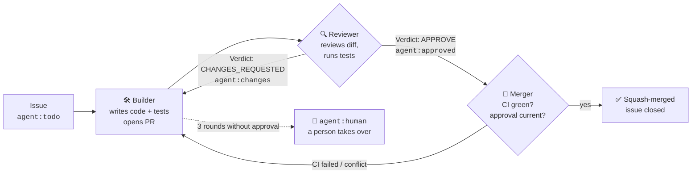
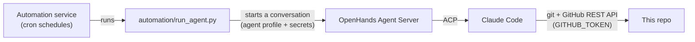

# agent-pipeline-demo

**Three AI agents that take a GitHub issue all the way to a merged pull request, with no human in the loop.**

A **Builder** agent writes the code and opens a PR, a **Reviewer** agent reviews it and either approves or
requests changes, and a **Merger** agent merges it once CI is green. They never talk to each other directly:
they coordinate only through **GitHub labels**, so every step is visible (and overridable) right here in the repo.

The code they work on, [`textkit`](textkit/), is deliberately tiny. The point of this repo is the pipeline,
not the library.

> Every PR in this repo after the initial scaffold was written, reviewed, and merged by the agents.
> See the [closed pull requests](https://github.com/rammanohar99/agent-pipeline-demo/pulls?q=is%3Apr+is%3Aclosed).

---

## How it works



Each agent runs on a schedule, handles **at most one item per run**, and moves the label forward as its last
step, so a crashed run leaves the item exactly where it was.

| Agent | Picks up | Does | Hands off as |
|---|---|---|---|
| **Builder** | PRs with `agent:changes` first, otherwise the oldest issue with `agent:todo` | Branches `agent/issue-<n>`, implements with tests, runs `ruff` + `pytest`, opens a PR with `Closes #<n>`; or addresses every reviewer comment on an existing PR | `agent:review` |
| **Reviewer** | Oldest PR with `agent:review` | Reads the issue and full diff, checks out the branch, runs lint + tests itself, posts one review ending in `Verdict: APPROVE` or `Verdict: CHANGES_REQUESTED` | `agent:approved` or `agent:changes` |
| **Merger** | Oldest PR with `agent:approved` | Verifies the approval is newer than the last commit, all checks passed, and there are no conflicts; then squash-merges and deletes the branch | merged (or back to `agent:review` / `agent:changes`) |

### The labels are the state machine

| Label | Meaning |
|---|---|
| `agent:todo` | Issue is ready for the Builder |
| `agent:in-progress` | Builder has claimed the issue |
| `agent:review` | PR is waiting for the Reviewer |
| `agent:changes` | Reviewer (or Merger) sent the PR back to the Builder |
| `agent:approved` | Reviewer approved; Merger merges when CI is green |
| `agent:human` | Agents gave up or a person took over. **Agents never touch it.** |

Because the state lives in labels, a human can step in at any point: relabel a PR to send it back, or add
`agent:human` to take it out of the pipeline entirely.

### The rules every agent follows

All three agents load [`AGENTS.md`](AGENTS.md) before doing anything. It defines the label protocol, the
one-item-per-run rule, and the code standards (type hints, docstrings, tests for every change, `ruff` and
`pytest` must pass). The per-role instructions live in [`.agents/prompts/`](.agents/prompts/).

---

## A real run: the review loop catching a bug

Issue [#2](https://github.com/rammanohar99/agent-pipeline-demo/issues/2) asked for
`truncate(text, max_len, suffix="...")`. What happened on [PR #5](https://github.com/rammanohar99/agent-pipeline-demo/pull/5):

1. **Builder** implemented it with six tests. CI passed.
2. **Reviewer** found an edge case the tests missed: `truncate("ab", 2)` raised `ValueError` even though the
   text already fits, contradicting the issue. It posted a repro and `Verdict: CHANGES_REQUESTED`.
3. **Builder** reordered the checks, added a regression test, and commented on what it changed.
4. **Reviewer** re-reviewed: `Verdict: APPROVE`.
5. **Merger** confirmed the approval postdated the fix and CI was green, then squash-merged.

Each agent run took 1 to 3 minutes. Issue [#3](https://github.com/rammanohar99/agent-pipeline-demo/issues/3)
then went from issue to merged in about 11 minutes, triggered entirely by the schedule.

---

## What powers it



- **[OpenHands Agent Canvas](https://github.com/OpenHands/OpenHands)** runs locally in Docker. It provides the
  agent server, the automation scheduler, and a UI where every agent run appears as a conversation you can watch.
- **Claude Code** is the agent doing the work, connected through the
  [Agent Client Protocol (ACP)](https://docs.openhands.dev/openhands/usage/agent-canvas/acp-agents).
- **[`automation/run_agent.py`](automation/run_agent.py)** is the glue: a standard-library-only script the
  scheduler runs for each role. It loads that role's prompt, starts a Claude Code conversation on the agent
  server with the saved secrets attached, waits for it to finish, and reports the result back to the scheduler.
- **GitHub Actions** ([`ci.yml`](.github/workflows/ci.yml)) runs `ruff` and `pytest` on every PR. Its result is
  the Merger's hard gate.

| Role | Schedule (Asia/Kolkata) |
|---|---|
| Builder | every 30 min (`:00`, `:30`) |
| Reviewer | `:05`, `:20`, `:35`, `:50` |
| Merger | `:10`, `:25`, `:40`, `:55` |

The schedules are staggered so a clean PR goes from built to merged in about 10 minutes.

Want to run your own copy? See **[docs/SETUP.md](docs/SETUP.md)**.

---

## Repository layout

```
.
├── AGENTS.md                 # Rules all agents load: label protocol + code standards
├── .agents/
│   ├── prompts/
│   │   ├── builder.md        # Builder role instructions
│   │   ├── reviewer.md       # Reviewer role instructions
│   │   └── merger.md         # Merger role instructions
│   └── seed-issues.md        # The starter issues the pipeline was tested on
├── automation/
│   └── run_agent.py          # Runner the scheduler executes for each role
├── textkit/                  # The library the agents build (written by agents)
├── tests/                    # pytest suite (written by agents)
├── .github/workflows/ci.yml  # ruff + pytest on every PR and push to main
└── docs/SETUP.md             # How to run the pipeline yourself
```

## The library itself

`textkit` is a handful of small string helpers. Everything except `capitalize_words` was implemented by the
Builder agent from an issue:

```python
from textkit import capitalize_words, slugify, truncate, word_count

capitalize_words("hello big world")             # "Hello Big World"
word_count("  hello   world  ")                 # 2
truncate("The quick brown fox jumps", 15)       # "The quick..."
slugify("Café, Hello World!")                   # "cafe-hello-world"
```

```bash
pip install -e ".[dev]"
ruff check . && pytest -q
```

---

## Limitations and lessons

- **It only does what's in the queue.** The agents don't decide what to build. Work enters only as issues a
  maintainer labels `agent:todo`. Only repo collaborators can apply labels, so outside users can't queue work.
- **Tests are the real safety net.** The Merger merges anything that passes CI and review, so weak tests mean
  bugs get merged automatically. Here the review loop caught one, but it won't catch everything.
- **The reviewer shares blind spots with the builder.** Both are the same model. Reviews are posted as
  comments with a verdict line rather than formal GitHub approvals, because GitHub doesn't let an account
  approve its own PR. A separate bot account would allow real approvals and branch protection.
- **It runs where the host runs.** On a laptop it pauses when the machine sleeps. For 24/7 operation, host Agent
  Canvas on an always-on server.
- **Every scheduled run costs model usage,** even when the queue is empty (roughly 10 short runs per hour).
- **Auto-merge is right for a playground, not for production.** For a real codebase, stop at `agent:approved`
  and let a human merge.

## Credits

Built with [OpenHands Agent Canvas](https://github.com/OpenHands/OpenHands) and
[Claude Code](https://www.anthropic.com/claude-code).

## License

[MIT](LICENSE). Use it, fork it, adapt the pipeline to your own repos.
